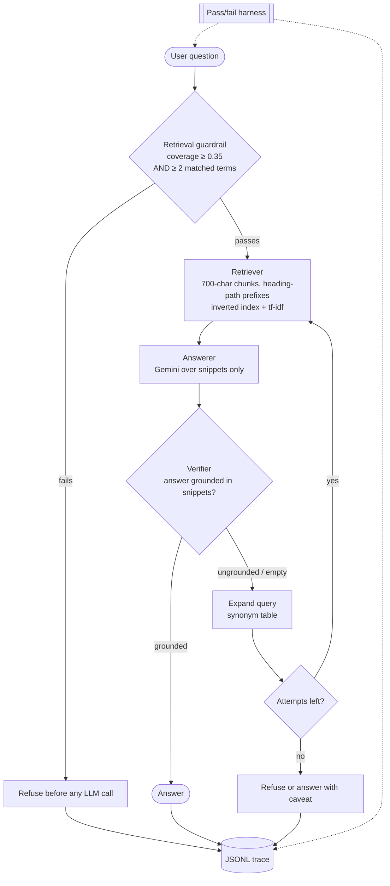

# DocuBot — an applied AI system with a verify-and-retry loop

DocuBot answers developer questions about a small documentation corpus and, more
importantly, is honest about when it cannot. This repo extends **DocuBot**
(AI110 Module 4 tinker) with an agentic retrieval loop, structured tracing, and
a pass/fail reliability harness.

**Base project:** [DocuBot](https://github.com/codepath/ai110-module4tinker-docubot-starter)
from AI110 Module 4. Its original goal was a teaching comparison: answer a
developer question three ways — naive LLM over the whole corpus, retrieval only,
and RAG over retrieved snippets — to show what retrieval buys you. It worked,
and it documented three of its own failures in a model card. This project takes
those documented failures as the work queue.

**One-line summary:** the original refused questions it could have answered; the
agentic loop retrieves, verifies its own answer against the snippets, and retries
with a widened query before giving up. Reliability went from **11/15 to 15/15**
on a pass/fail harness, with the same retriever underneath.

---

## Architecture

Source: [`diagrams/architecture.mmd`](diagrams/architecture.mmd) (Mermaid — open
it in GitHub, Obsidian, or the Mermaid live editor).



Where the human check lives: the harness defines what "pass" means, the JSONL
trace records what actually happened each attempt, and the model card records
what is still broken. Nothing in the loop self-grades its own success.

## What changed from the base project

| Base behaviour | This project | Why |
|---|---|---|
| One retrieve → one answer | retrieve → answer → **verify** → expand → retry (max 3) | the base refused answerable single-term queries |
| Hit-rate-only evaluation | pass/fail harness over 15 cases, oneshot vs agentic | hit rate hid refusal failures |
| No run trace | JSONL per attempt, flushed before the next call | evidence survives a crash |
| Answers unverified | deterministic grounding check (term overlap ≥ 0.60) | cheap, offline-testable, explainable |

## Setup

```bash
python3 -m venv .venv
.venv/bin/pip install -r requirements.txt
cp .env.example .env        # then set GEMINI_API_KEY
python main.py              # modes 1–4
```

Retrieval, verification and the harness all run with **no API key**. Only modes
1 and 3 and `harness.py --llm` call Gemini.

## Sample interactions

**1. The documented failure, now answered.** Single attempt returns nothing; the
loop expands the query and answers on the second pass:

```text
Question: How do I authenticate?
  attempt 0: query='How do I authenticate?'           retrieved=[]                grounded=False reason=no_results
  attempt 1: query='How do I authenticate? auth token' retrieved=[AUTH.md ×3]      grounded=True  ratio=0.73
Status: answered | attempts: 2 (retried)

Answer: Authentication uses a bearer token. Access tokens are created by
generate_access_token() in auth_utils.py, which takes a user_id and returns a
signed JWT containing user_id, issued-at and expiry.
```

**2. Off-topic stays refused.** No expansion is possible, so the loop stops
instead of inventing an answer:

```text
Question: What is the capital of France?
  attempt 0: retrieved=[] grounded=False reason=no_results
Status: refused | attempts: 1
Answer: I do not know based on these docs.
```

**3. A normal question, one attempt:**

```text
Question: Where is the auth token generated?
Status: answered | attempts: 1 | ratio=0.62
Files relied on: AUTH.md
```

## Testing

```bash
python3 -m unittest discover -s tests -v   # 18 tests, offline, no API key
python3 harness.py                          # 15 cases, oneshot vs agentic
python3 harness.py --llm                    # same, with real Gemini answers
```

Harness summary (deterministic, retrieval-level):

| System | Passed |
|---|---|
| Oneshot (base behaviour) | **11 / 15** |
| Agentic loop | **15 / 15** |

Fixed by the loop — all one class of failure, where a single term cannot clear
the two-term guardrail:

- `How do I authenticate?` → refused → **answered**
- `authenticate` → refused → **answered**
- `login` → refused → **answered**
- `database` → refused → **answered**

Not fixed: **ranking**. The loop does not change which document comes first, so
the documented "right document ranked second" failure is still there. A 15/15
pass rate means "did the right kind of thing", not "put the best snippet first".

Full tables: [`assets/harness_results.md`](assets/harness_results.md). Raw trace
from a live three-query run: [`assets/agentic_trace.jsonl`](assets/agentic_trace.jsonl).

## Design decisions and trade-offs

- **Deterministic verifier, not an LLM judge.** A second model call to check the
  first would double cost and make tests non-deterministic. Term overlap is
  crude — it cannot detect a fluent answer that swaps a date — but it can be
  unit-tested, and the failure it is targeting is "answered from nothing".
- **Synonym table instead of LLM query expansion.** Same reasoning: the failure
  is lexical, so the fix can be lexical. Trade-off: a new domain needs new
  entries, and the table will not generalise to arbitrary corpora.
- **Bounded retries (3).** Unbounded self-correction is how agents spiral. The
  third failure is a refusal, deliberately.
- **Refusal counts as non-terminal.** A first version treated the refusal as a
  successfully verified answer, so empty retrieval never retried — the exact bug
  the project exists to fix. Tests caught it.
- **Trace before the next call.** If the process dies mid-run, the evidence up to
  that point is already on disk.

## Repo layout

```
agent.py                     verify-and-retry loop, verifier, expansion, tracing
harness.py                   pass/fail harness, oneshot vs agentic
docubot.py                   retriever (from the base project, unchanged)
main.py                      CLI: modes 1–4
tests/test_agent.py          18 offline tests
diagrams/architecture.mmd    Mermaid source for the diagram above
assets/harness_results.md    harness output
assets/agentic_trace.jsonl   live run trace
baseline.md                  the "before" numbers, recorded before changes
model_card.md                limitations, misuse, reliability surprises, AI collaboration
```

## What this project says about me as an AI engineer

I took a working prototype's own documented weaknesses, turned them into a test
plan, and fixed one class of them with the smallest mechanism that would work —
then measured the result honestly, including what the fix does **not** cover.

## Presentation outline (5–7 min)

1. The base system and its three documented failures (1 min)
2. Why a hit rate of 0.88 hid a refusal problem (1 min)
3. The loop: retrieve → answer → verify → expand → retry (2 min, live demo of
   `How do I authenticate?` before/after)
4. Harness: 11/15 → 15/15, and the four cases that flipped (1 min)
5. What is still broken: ranking, deterministic verifier limits, synonym table
   maintenance (1 min)
6. What I'd do next: LLM-judged grounding as a second opinion, BM25 ranking fix
   (30 s)

Scope note: the base project is a Module 4 tinker; the Unit 8 brief allows
Modules 1–3 as a base but its own overview maps retrieval to "Modules 3–4".
Confirming that with the course staff was flagged before the work started.
